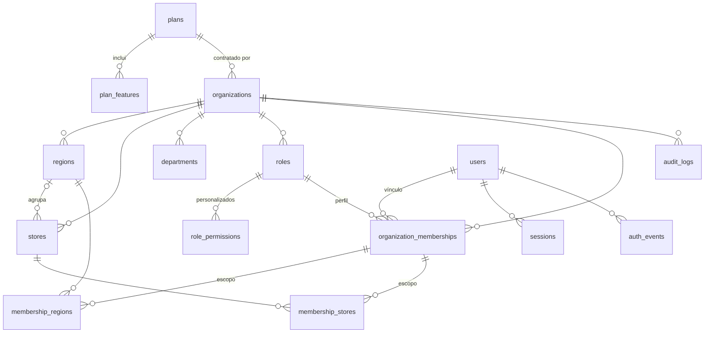
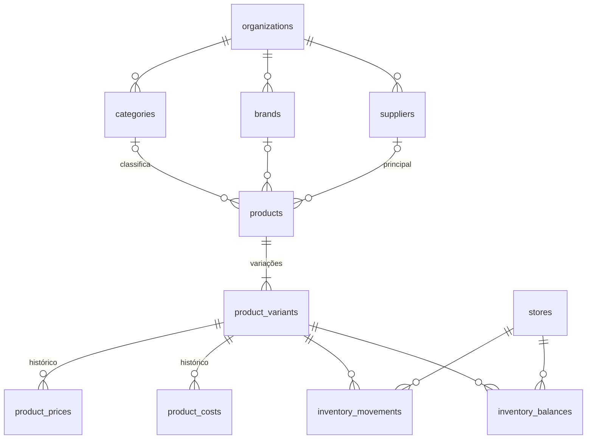

# Modelo de dados

Fonte de verdade: `src/db/schema/*.ts` e SQL versionado em `drizzle/` (`0000` schema, `0001` FORCE RLS, `0002` catálogo de planos, `0003` dono da conta e FK de região restritiva, `0004` nomes de perfis e Financeiro, `0005` catálogo e estoque, `0006` FORCE RLS do catálogo e estoque). Este documento explica o desenho; não repete colunas óbvias.

## Implementado (Fase 1)

| Tabela | Escopo | Notas |
|---|---|---|
| `plans`, `plan_features` | Global | Catálogo comercial (hipótese) semeado pela migration `0002`; `NULL` em limite = sem limite |
| `organizations` | Tenant (raiz) | CNPJ único na plataforma (14 caracteres, alfanumérico aceito), plano, situação, fuso |
| `regions` | Tenant | Nome único por empresa sem diferenciar maiúsculas |
| `stores` | Tenant | Código único por empresa; região por FK composta; fuso opcional (herda da empresa); sem exclusão física |
| `departments` | Tenant | Catálogo da empresa (setores); ativo/inativo |
| `roles` | Tenant | 8 perfis do sistema por empresa + personalizados; `rank` para hierarquia. A migration `0004` renomeia Dono e Coordenador e cria o Financeiro nas empresas existentes |
| `role_permissions` | Tenant | Só para perfis personalizados; permissões do sistema vêm do código |
| `organization_memberships` | Tenant | Usuário × empresa, perfil, `store_access` (`all`/`regions`/`stores`), situação |
| `membership_regions`, `membership_stores` | Tenant | Escopo do vínculo; FKs compostas impedem ids de outra empresa; região referenciada não pode ser excluída (FK sem cascata, migration `0003`) |
| `audit_logs` | Tenant | Somente inserção e leitura; `changes` guarda campos de negócio alterados |
| `users` | Global | E-mail normalizado único; hash scrypt; troca de senha obrigatória; flag de administrador da plataforma; `home_organization_id` = empresa que criou a conta (só ela pode readicioná-la sem confirmação por e-mail) |
| `sessions` | Global | Id = SHA-256 do token; empresa e loja ativas da sessão |
| `auth_rate_limits`, `auth_events` | Global | Chaves e identificadores em HMAC |

**Convenções:** UUID v4 (`gen_random_uuid()`), `timestamptz`, `created_at`/`updated_at`; enums PostgreSQL para estados; toda tabela de tenant tem `UNIQUE (organization_id, id)` para servir de alvo de FKs compostas e índices iniciando por `organization_id`. Exclusões: `CASCADE` a partir da organização e dos vínculos; regiões em uso por vínculos não são excluídas; lojas não são excluídas.

**Transações e corrida:** limites de plano travam a linha da organização (`SELECT … FOR UPDATE`) antes de contar; violações de unicidade concorrentes viram conflitos amigáveis.

## Implementado (Fase 2, incremento 1 — catálogo e estoque por livro, somente back-end)

Migrations `0005` (tabelas, políticas, FKs, checks) e `0006` (FORCE RLS). Todas as tabelas têm `organization_id` com FK em cascata para `organizations`, RLS forçado e FKs compostas `(organization_id, id)` para os pais; nenhuma é excluída fisicamente (desativação no lugar de exclusão).

| Tabela | Notas |
|---|---|
| `categories`, `brands` | Lista plana da empresa; nome único sem diferenciar maiúsculas; ativo/inativo (inativos não são oferecidos a produtos novos, mas continuam nos existentes) |
| `suppliers` | Nome, CNPJ opcional (único por empresa quando informado), e-mail, telefone; ativo/inativo. Fornecedor principal do produto; pedidos de compra ficam para depois |
| `products` | Nome, descrição (até 1000 caracteres), unidade (`un`, `kg`, `l`, `m`; fixa após o cadastro), categoria, marca e fornecedor por FK composta |
| `product_variants` | Unidade vendida e estocada: todo produto tem ao menos uma (produto simples = uma variação). Nome único no produto; SKU (maiúsculas) único por empresa; código de barras GTIN (8/12/13/14 dígitos com dígito verificador) único por empresa quando informado; até 50 por produto |
| `product_prices`, `product_costs` | Somente inserção e leitura (como `audit_logs`); valor em centavos `bigint ≥ 0`; vigente = linha mais recente (`valid_from` com `clock_timestamp()` sob trava da variação). Preço único para todas as lojas |
| `inventory_movements` | Livro imutável (só inserção e leitura): `entry`, `exit`, `adjustment`, `loss`, `count`; `quantity` com sinal (inventário = contado − saldo anterior), `balance_after`, `counted_quantity` só em inventário, motivo obrigatório, autor. Checks garantem sinal por tipo e saldo ≥ 0 |
| `inventory_balances` | Chave `(organization_id, store_id, variant_id)`; leitura, inserção e alteração pelo tenant, **sem exclusão**; check `quantity ≥ 0`. Escrito só pelo serviço de estoque, na mesma transação da movimentação |

**Saldo atômico:** o serviço cria a linha de saldo em zero se faltar, trava com `SELECT … FOR UPDATE`, calcula em milésimos (`bigint`, sem ponto flutuante), recusa saldo negativo, atualiza o saldo e grava a movimentação e a auditoria na mesma transação. Movimentações concorrentes na mesma loja/variação são serializadas; a ordem do livro segue a ordem da trava.

**Quantidades:** `numeric(14,3)`; produtos em `un` aceitam só inteiros.

## Planejado (Fases 2–6)

Nomes seguem a sugestão do prompt, ajustados à convenção `snake_case` plural. Todas as tabelas comerciais terão `organization_id`, RLS forçado e FKs compostas.

| Fase | Tabelas | Decisões já tomadas |
|---|---|---|
| 2 | `stock_transfers`, `stock_transfer_items`, `inventory_counts` | Transferência com estados solicitada → aprovada → em trânsito → recebida/cancelada; reserva e trânsito no saldo; contagem por lote (hoje o inventário é lançado item a item no livro) |
| 2–8 | `purchase_orders`, `purchase_order_items`, `goods_receipts` | Recebimento contra pedido gera movimentação no livro de estoque; custo de reposição versionado |
| 2–4 | `expenses`, `payment_reconciliations` | Despesas por loja e período; conciliação com o retorno do provedor de pagamento |
| 2 | `customers` | Dados pessoais mínimos (LGPD); CPF opcional conforme configuração |
| 2 | `cash_registers`, `cash_sessions`, `cash_movements` | Uma sessão aberta por caixa; reabertura autorizada e auditada |
| 2 | `sales`, `sale_items`, `payments`, `refunds`, `idempotency_keys` | Valores em centavos (`bigint`); número da venda sequencial por loja; chave de idempotência por finalização; pagamento externo só confirmado pelo provedor |
| 2 | `fiscal_documents` | Estado e protocolo vindos do provedor; nunca gerados localmente |
| 3 | `salespeople`, `work_schedules`, `sales_targets`, `commission_rules` (versionadas), `commission_entries`, `campaigns` | Metas por escopo e período sem alteração retroativa silenciosa; comissão estimada/apurada/aprovada/paga |
| 3 | `service_tickets`, `service_events` | Status do prompt; reordenação manual exige motivo; venda vinculada sem dupla contagem |
| 4 | `reports`, `report_runs`, `report_schedules` | Filtros e escopo gravados por execução |
| 5 | `conversations`, `ai_messages`, `ai_tool_runs`, `ai_usage_records` | Uso e custo por organização e usuário |
| 6 | `alerts`, `alert_rules`, `tasks`, `task_events`, `procedures` | Alertas determinísticos; tarefas criadas por ação humana |
| 2–7 | `integrations`, `import_jobs`, `import_rows`, `organization_settings`, `store_settings` | Configurações tipadas por coluna (sem JSON genérico) quando surgirem regras reais |

## Ciclo de migrations

1. Alterar `src/db/schema/`.
2. `pnpm db:generate` (sem conexão) e revisar o SQL em `drizzle/`. Alterações que o drizzle-kit não gera (ex.: `FORCE ROW LEVEL SECURITY` em tabela nova) vão numa migration `--custom`.
3. Aplicar com `pnpm db:migrate` usando `DATABASE_MIGRATION_URL` (dono do schema), no destino correto. Nunca no build ou em requisições.
4. Preferir mudanças aditivas; não reescrever migrations aplicadas.
