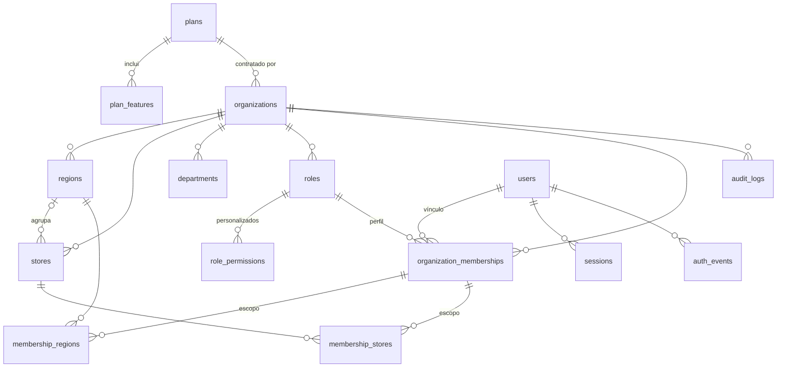
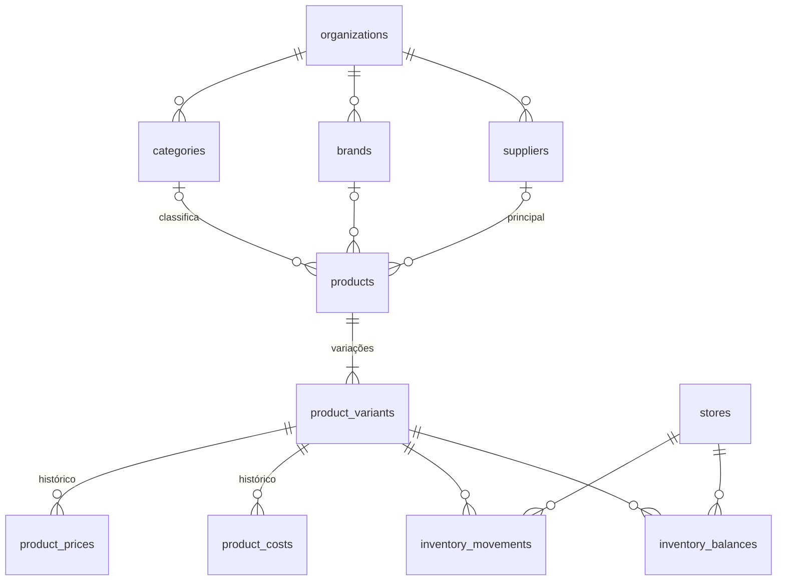

# Modelo de dados

Fonte de verdade: `src/db/schema/*.ts` e SQL versionado em `drizzle/` (`0000` schema, `0001` FORCE RLS, `0002` catálogo de planos, `0003` dono da conta e FK de região restritiva, `0004` nomes de perfis e Financeiro, `0005` catálogo e estoque, `0006` FORCE RLS do catálogo e estoque, `0007` regras de operação, `0008` FORCE RLS das regras de operação, `0009` clientes, `0010` FORCE RLS de clientes, `0011` compras e contador de documentos, `0012` FORCE RLS de compras, `0013` transferências e reservas, `0014` FORCE RLS de transferências e reservas, `0015` caixa, `0016` FORCE RLS do caixa, `0017` vendas, `0018` FORCE RLS de vendas, `0019` pagamentos integrados, `0020` FORCE RLS de pagamentos, `0021` documentos fiscais, `0022` FORCE RLS de documentos fiscais, `0023` cancelamentos, devoluções e chave da suspensão, `0024` FORCE RLS das devoluções, `0025` inventários por lote, `0026` FORCE RLS dos inventários, `0027` importações CSV, `0028` FORCE RLS das importações, `0029` calendário da empresa, `0030` FORCE RLS do calendário). Este documento explica o desenho; não repete colunas óbvias.

## Implementado (Fase 1)

| Tabela | Escopo | Notas |
|---|---|---|
| `plans`, `plan_features` | Global | Catálogo comercial (hipótese) semeado pela migration `0002`; `NULL` em limite = sem limite |
| `organizations` | Tenant (raiz) | CNPJ único na plataforma (14 caracteres, alfanumérico aceito), plano, situação, fuso |
| `regions` | Tenant | Nome único por empresa sem diferenciar maiúsculas |
| `stores` | Tenant | Código único por empresa; região por FK composta; fuso opcional (herda da empresa); sem exclusão física |
| `departments` | Tenant | Catálogo da empresa (setores); ativo/inativo |
| `roles` | Tenant | 8 perfis do sistema por empresa + personalizados; `rank` para hierarquia. A migration `0004` renomeia Dono e Coordenador e cria o Financeiro nas empresas existentes |
| `role_permissions` | Tenant | Só para perfis personalizados; permissões do sistema vêm do código |
| `organization_memberships` | Tenant | Usuário × empresa, perfil, `store_access` (`all`/`regions`/`stores`), situação |
| `membership_regions`, `membership_stores` | Tenant | Escopo do vínculo; FKs compostas impedem ids de outra empresa; região referenciada não pode ser excluída (FK sem cascata, migration `0003`) |
| `audit_logs` | Tenant | Somente inserção e leitura; `changes` guarda campos de negócio alterados |
| `users` | Global | E-mail normalizado único; hash scrypt; troca de senha obrigatória; flag de administrador da plataforma; `home_organization_id` = empresa que criou a conta (só ela pode readicioná-la sem confirmação por e-mail) |
| `sessions` | Global | Id = SHA-256 do token; empresa e loja ativas da sessão |
| `auth_rate_limits`, `auth_events` | Global | Chaves e identificadores em HMAC |

**Convenções:** UUID v4 (`gen_random_uuid()`), `timestamptz`, `created_at`/`updated_at`; enums PostgreSQL para estados; toda tabela de tenant tem `UNIQUE (organization_id, id)` para servir de alvo de FKs compostas e índices iniciando por `organization_id`. Exclusões: `CASCADE` a partir da organização e dos vínculos; regiões em uso por vínculos não são excluídas; lojas não são excluídas.

**Transações e corrida:** limites de plano travam a linha da organização (`SELECT … FOR UPDATE`) antes de contar; violações de unicidade concorrentes viram conflitos amigáveis.

## Implementado (Fase 2, incremento 1 — catálogo e estoque por livro, somente back-end)

Migrations `0005` (tabelas, políticas, FKs, checks) e `0006` (FORCE RLS). Todas as tabelas têm `organization_id` com FK em cascata para `organizations`, RLS forçado e FKs compostas `(organization_id, id)` para os pais; nenhuma é excluída fisicamente (desativação no lugar de exclusão).

| Tabela | Notas |
|---|---|
| `categories`, `brands` | Lista plana da empresa; nome único sem diferenciar maiúsculas; ativo/inativo (inativos não são oferecidos a produtos novos, mas continuam nos existentes) |
| `suppliers` | Nome, CNPJ opcional (único por empresa quando informado), e-mail, telefone; ativo/inativo. Fornecedor principal do produto; pedidos de compra ficam para depois |
| `products` | Nome, descrição (até 1000 caracteres), unidade (`un`, `kg`, `l`, `m`; fixa após o cadastro), categoria, marca e fornecedor por FK composta |
| `product_variants` | Unidade vendida e estocada: todo produto tem ao menos uma (produto simples = uma variação). Nome único no produto; SKU (maiúsculas) único por empresa; código de barras GTIN (8/12/13/14 dígitos com dígito verificador) único por empresa quando informado; até 50 por produto |
| `product_prices`, `product_costs` | Somente inserção e leitura (como `audit_logs`); valor em centavos `bigint ≥ 0`; vigente = linha mais recente (`valid_from` com `clock_timestamp()` sob trava da variação). Preço único para todas as lojas |
| `inventory_movements` | Livro imutável (só inserção e leitura): `entry`, `exit`, `adjustment`, `loss`, `count`; `quantity` com sinal (inventário = contado − saldo anterior), `balance_after`, `counted_quantity` só em inventário, motivo obrigatório, autor. Checks garantem sinal por tipo e saldo ≥ 0 |
| `inventory_balances` | Chave `(organization_id, store_id, variant_id)`; leitura, inserção e alteração pelo tenant, **sem exclusão**; check `quantity ≥ 0`. Escrito só pelo serviço de estoque, na mesma transação da movimentação |

**Saldo atômico:** o serviço cria a linha de saldo em zero se faltar, trava com `SELECT … FOR UPDATE`, calcula em milésimos (`bigint`, sem ponto flutuante), recusa saldo negativo, atualiza o saldo e grava a movimentação e a auditoria na mesma transação. Movimentações concorrentes na mesma loja/variação são serializadas; a ordem do livro segue a ordem da trava.

**Quantidades:** `numeric(14,3)`; produtos em `un` aceitam só inteiros.

## Implementado (Fase 2 — regras de operação, módulo m27)

Migrations `0007` (tabelas, políticas, FKs, checks) e `0008` (FORCE RLS).

| Tabela | Notas |
|---|---|
| `organization_settings` | Uma linha por empresa (chave = `organization_id`): `customer_requirement` (`none`/`optional`/`required`), `max_discount_bps` (0 a 10 000, pontos-base), cabeçalho e rodapé do comprovante (até 240 caracteres). Linha ausente = padrão (cliente opcional, teto 0, sem textos); nada é semeado |
| `store_settings` | Exceção por loja, chave `(organization_id, store_id)` com FK composta para `stores` (cascata). Cada coluna nula herda da empresa; a linha é apagada quando as três colunas voltam a nulo |

Leitura efetiva (`loadEffectiveSettings`): campo da loja não nulo vence; senão o da empresa; senão o padrão. Gravação: a linha é criada se faltar e travada com `SELECT … FOR UPDATE` antes da comparação, então a auditoria registra só os campos que mudaram.

## Implementado (Fase 2 — clientes, módulo m28a)

Migrations `0009` (tabela, política, índices, checks) e `0010` (FORCE RLS).

| Tabela | Notas |
|---|---|
| `customers` | Clientes da **empresa** (sem escopo de loja), com dados mínimos (ADR-017): nome, CPF opcional (11 dígitos, único por empresa quando informado), e-mail (minúsculo) e telefone (só dígitos) opcionais, consentimento de contato com data (`consent_at` presente só com consentimento, garantido por check), ativo/inativo. `UNIQUE (organization_id, id)` para as FKs compostas de vendas e fila. Índices por nome (`lower`), e-mail e telefone. Sem exclusão física |

O CPF completo só sai do serviço para quem tem `customers.documents.read`; os demais recebem `***.456.789-**`. A auditoria guarda CPF, e-mail e telefone sempre mascarados.

## Implementado (Fase 2 — compras, módulo m29a)

Migrations `0011` (tabelas, políticas, FKs, checks) e `0012` (FORCE RLS).

| Tabela | Notas |
|---|---|
| `document_counters` | Chave `(organization_id, scope)`; `last_value` incrementado dentro da transação que cria o documento (a linha fica travada até o commit; rollback devolve o número). Escopos: `purchase_order` e, no PDV, `sale:{loja}` (ADR-014) |
| `purchase_orders` | Número único por empresa; loja de destino e fornecedor por FK composta; situação `draft` → `approved` → `partially_received` → `received`, ou `cancelled`; checks de coerência para cancelamento e encerramento com pendências |
| `purchase_order_items` | Uma linha por variação no pedido; `quantity_received` entre 0 e `quantity_ordered` (check); custo unitário em centavos. Substituídos só enquanto o pedido é rascunho |
| `goods_receipts`, `goods_receipt_items` | Somente inserção e leitura. Chave de idempotência única por empresa; cada item aponta para o movimento de estoque (`entry`) que criou, por FK composta |

**Recebimento atômico:** numa transação, o serviço trava o pedido e os itens, confere a chave de idempotência (repetida = mesmo recebimento), recusa quantidade acima do pendente, lança a entrada no livro por `postLedgerEntry` em ordem crescente de variação, grava o custo de reposição por `recordCostInTx` (só quando muda; auditoria com `source: "purchase_receipt"`), atualiza o recebido e a situação, e audita.

## Implementado (Fase 2 — transferências e reservas, módulo m30a)

Migrations `0013` (tabelas novas e colunas `reserved`/`in_transit` em `inventory_balances`) e `0014` (FORCE RLS).

| Tabela | Notas |
|---|---|
| `inventory_balances` (alterada) | `reserved` (soma das reservas ativas; check `0 ≤ reserved ≤ quantity`) e `in_transit` (enviado por transferências ainda não recebidas na loja de destino). Disponível = `quantity − reserved` |
| `inventory_reservations` | Reserva de uma quantidade numa loja e variação, com origem (`transfer` ou `sale`) e situação `active` → `released` ou `consumed` (check de datas coerentes) |
| `stock_transfers` | Número único por empresa; origem ≠ destino (check); `requested` → `approved` → `in_transit` → `received`, ou `cancelled` |
| `stock_transfer_items` | Solicitado, enviado (≤ solicitado) e recebido (≤ enviado), motivo de divergência, reserva e ids dos movimentos de saída e de entrada (FKs compostas) |

**Fluxo:** a aprovação reserva na origem; o despacho consome a reserva, lança `exit` na origem e soma o enviado ao `in_transit` do destino; o recebimento tira o enviado do trânsito e lança `entry` do recebido no destino. Diferença entre enviado e recebido fica no item, com motivo obrigatório, sem movimento de loja. Movimentos manuais não podem deixar a quantidade abaixo do reservado. Cada etapa trava a transferência e as linhas de saldo em ordem (loja, variação).

## Implementado (Fase 2 — caixa, módulo m05a)

Migrations `0015` (tabelas, políticas, índices, checks) e `0016` (FORCE RLS).

| Tabela | Notas |
|---|---|
| `cash_registers` | Caixas por loja; nome único na loja sem diferenciar maiúsculas; ativo/inativo (não desativa com sessão aberta) |
| `cash_sessions` | Abertura (troco inicial, operador, chave de idempotência única), fechamento (contado, esperado, diferença, observação) com check de coerência por situação. Índices únicos parciais: uma sessão aberta por caixa e uma por operador |
| `cash_movements` | Livro de dinheiro, somente inserção e leitura: `opening`, `supply`, `withdrawal` (motivo obrigatório), `sale` e `refund` (referência obrigatória, alimentados pelo PDV e pelas devoluções). Chave de idempotência única quando informada |
| `cash_session_events` | Somente inserção e leitura: abertura, fechamento (com contado, esperado e diferença) e reabertura (com motivo) |

**Esperado:** abertura + suprimentos − sangrias + vendas em dinheiro − devoluções em dinheiro, sempre somado do livro no servidor. Sangria e devolução em dinheiro não passam do esperado. A reabertura volta a sessão para `open`, limpa os campos de fechamento (o fechamento anterior fica no evento) e só vale para a sessão mais recente do caixa.

## Implementado (Fase 2 — vendas do PDV, módulo m06a)

Migrations `0017` (tabelas, enums, políticas, checks) e `0018` (FORCE RLS).

| Tabela | Notas |
|---|---|
| `sales` | Venda da loja: `suspended` → `completed` (ou `discarded`; `cancelled` fica para o m08). Finalizada tem número sequencial por loja (`UNIQUE (organization_id, store_id, number)`), chave de finalização única por empresa (ADR-013), sessão de caixa, totais em centavos com check `total = subtotal − desconto + acréscimo`, troco e cópia do cabeçalho/rodapé do comprovante |
| `sale_items` | Linha com cópia de nome, SKU, unidade, preço e **custo vigentes** na finalização (ADR-016), desconto e total; reserva (venda suspensa) e movimento de saída do estoque por FK composta |
| `sale_payments` | Somente inserção e leitura. Dinheiro (recebido e troco com check) e cartão em maquininha externa (NSU obrigatório); `pix`/`card_provider` e os status `pending`/`failed`/`refunded` ficam previstos para o m07 |

**Finalização:** uma transação trava a sessão de caixa do operador, confere a chave (repetida = mesma venda), aplica a regra de cliente da loja (m27), lê preço e custo no servidor (preço diferente do carrinho = conflito), confere desconto e acréscimo pelo teto da loja e pelas permissões, exige soma exata dos pagamentos, numera (`sale:{loja}` no contador), baixa o estoque em ordem de variação, lança no caixa só o dinheiro aplicado, grava itens, pagamentos e auditoria. **Suspensão:** grava a venda `suspended` com os itens reservados; retomar e finalizar consome as reservas antes da baixa; descartar as libera.

## Implementado (Fase 2 — pagamentos integrados, módulo m07)

Migrations `0019` e `0020` (FORCE RLS em `payment_intents` e `payment_events`).

| Tabela | Notas |
|---|---|
| `payment_intents` | Intenção de PIX ou cartão integrado criada pelo operador antes da venda (loja, sessão de caixa, valor, chave de idempotência única), com o estado que **só o provedor** muda: `pending` → `confirmed`/`failed`/`cancelled`; `confirmed` → `refunded`. `sale_id` marca a venda que a usou (check: só confirmada). Referência única por provedor |
| `payment_events` | Somente inserção e leitura: cada evento recebido (webhook ou consulta), único por `(provider, event_id)` — repetição não tem efeito |
| `payment_provider_references` | Tabela **global** sem RLS (como `auth_rate_limits`): mapa `(provedor, referência) → empresa, intenção`, lido pelo webhook, que chega sem sessão. Só ids |

Nenhum provedor real está ligado: sem `PAYMENT_PROVIDER`, PIX e cartão integrado ficam indisponíveis com mensagem clara, e nada é simulado.

## Implementado (Fase 2 — interface fiscal, módulo m09)

Migrations `0021` e `0022` (FORCE RLS).

| Tabela | Notas |
|---|---|
| `fiscal_documents` | Um documento (NFC-e) por venda (`UNIQUE (organization_id, sale_id, kind)`), com estado `not_configured` (sem provedor), `pending`, `authorized`, `rejected`, `cancelled` ou `contingency`. Chave de acesso, número, série e protocolo só vêm da resposta do provedor; o banco recusa `authorized` sem chave de 44 dígitos, número e protocolo, e `not_configured` com provedor |

Nenhum provedor fiscal está ligado: o pedido fica `not_configured` e o comprovante do PDV continua "Documento sem valor fiscal".

## Implementado (Fase 2 — cancelamentos e devoluções, módulo m08)

Migrations `0023` e `0024` (FORCE RLS). A `0023` também acrescenta `sales.suspension_key` (única por empresa), que torna a suspensão idempotente.

| Tabela | Notas |
|---|---|
| `sale_refunds` | Somente inserção e leitura. `cancellation` (venda inteira, método `original`: cada pagamento volta pelo seu meio) ou `return` (itens, por `cash` na sessão aberta de quem devolve ou `card_external` com NSU). Valor total, parte em dinheiro, chave de idempotência única por empresa, sessão de caixa |
| `sale_refund_items` | Somente inserção e leitura. Linha da venda, quantidade, valor e se voltou ao estoque (com o movimento `entry`) |

**Valores:** cada linha vale o total líquido dela ajustado pelo desconto ou acréscimo da venda (arredondado para baixo); a devolução que esgota a linha leva o resto do arredondamento, e a que esgota a venda devolve exatamente o que falta do total. Cancelamento só com a sessão de caixa da venda aberta e sem devolução anterior; a venda fica `cancelled`. Pagamentos integrados são estornados pelo provedor depois do commit.

## Implementado (Fase 2 — inventário por lote, módulo m31)

Migrations `0025` e `0026` (FORCE RLS).

| Tabela | Notas |
|---|---|
| `inventory_counts` | Número por empresa (contador `inventory_count`), loja, situação `open` → `approved` ou `cancelled` (check de coerência dos campos), filtro opcional de categoria/marca, observação, abertura/aprovação/cancelamento com responsável e motivo. Índice único parcial: um inventário `open` por loja |
| `inventory_count_items` | Variação, saldo do sistema na abertura (oculto na contagem cega), quantidade contada (a última registrada vale) com quem/quando, movimento `count` gerado na aprovação |

**Itens do inventário:** itens ativos do catálogo (do filtro) mais qualquer variação com saldo na loja, inclusive inativa; no máximo 5.000 por inventário (acima disso, filtrar por categoria ou marca). **Aprovação:** trava os saldos em ordem de variação, recusa contado abaixo do reservado e lança `count` só onde o contado difere do saldo **atual**; itens não contados ficam como estão. A revisão sinaliza itens movimentados entre a abertura e a aprovação.

## Implementado (Fase 2 — importação CSV, módulo m19)

Migrations `0027` e `0028` (FORCE RLS). O arquivo nunca é guardado: só as linhas normalizadas.

| Tabela | Notas |
|---|---|
| `imports` | Número por empresa (contador `import`), tipo (`products`, `customers`, `opening_stock` com loja), situação `previewed` → `applying` → `done` ou `discarded`, nome do arquivo, total de linhas, quem enviou/confirmou |
| `import_mappings` | Campo da importação → coluna do arquivo |
| `import_rows` | Linha do arquivo, situação (`ok`, `error`, `skipped`, `applied`, `failed`), mensagens e valores já normalizados pelo Zod dos serviços em colunas por tipo; id criado na aplicação. Contém dados pessoais de clientes: apagar 30 dias após a confirmação (rotina pendente da infraestrutura de tarefas); descartar a prévia apaga as linhas |

## Implementado (Fase 3 — calendário da empresa, módulo m32a)

Migrations `0029` e `0030` (FORCE RLS).

| Tabela | Notas |
|---|---|
| `calendar_holidays` | Data, nome, tipo (`holiday` sempre fechado; `optional` só fecha com `closed`), loja (NULL = todas as lojas). Uma data por empresa e uma por loja (índices únicos parciais). Exclusão física, auditada |
| `store_work_weeks` | Dias de trabalho da loja (0 = domingo … 6 = sábado, 1 a 7 valores); ausente = segunda a sexta |

`loadCalendarOptions` monta as opções do m01 (`src/lib/business-days.ts`) para escalas e metas: dias fechados da empresa e da loja no período, e a semana da loja.

## Planejado (Fases 2–6)

Nomes seguem a sugestão do prompt, ajustados à convenção `snake_case` plural. Todas as tabelas comerciais terão `organization_id`, RLS forçado e FKs compostas.

| Fase | Tabelas | Decisões já tomadas |
|---|---|---|
| 2 | `stock_transfers`, `stock_transfer_items`, `inventory_counts` | Transferência com estados solicitada → aprovada → em trânsito → recebida/cancelada; reserva e trânsito no saldo; contagem por lote (hoje o inventário é lançado item a item no livro) |
| 2–8 | `purchase_orders`, `purchase_order_items`, `goods_receipts` | Recebimento contra pedido gera movimentação no livro de estoque; custo de reposição versionado |
| 2–4 | `expenses`, `payment_reconciliations` | Despesas por loja e período; conciliação com o retorno do provedor de pagamento |
| 2 | `customers` | Dados pessoais mínimos (LGPD); CPF opcional conforme configuração |
| 2 | `cash_registers`, `cash_sessions`, `cash_movements` | Uma sessão aberta por caixa; reabertura autorizada e auditada |
| 2 | `sales`, `sale_items`, `payments`, `refunds`, `idempotency_keys` | Valores em centavos (`bigint`); número da venda sequencial por loja; chave de idempotência por finalização; pagamento externo só confirmado pelo provedor |
| 2 | `fiscal_documents` | Estado e protocolo vindos do provedor; nunca gerados localmente |
| 3 | `salespeople`, `work_schedules`, `sales_targets`, `commission_rules` (versionadas), `commission_entries`, `campaigns` | Metas por escopo e período sem alteração retroativa silenciosa; comissão estimada/apurada/aprovada/paga |
| 3 | `service_tickets`, `service_events` | Status do prompt; reordenação manual exige motivo; venda vinculada sem dupla contagem |
| 4 | `reports`, `report_runs`, `report_schedules` | Filtros e escopo gravados por execução |
| 5 | `conversations`, `ai_messages`, `ai_tool_runs`, `ai_usage_records` | Uso e custo por organização e usuário |
| 6 | `alerts`, `alert_rules`, `tasks`, `task_events`, `procedures` | Alertas determinísticos; tarefas criadas por ação humana |
| 2–7 | `integrations`, `import_jobs`, `import_rows`, `organization_settings`, `store_settings` | Configurações tipadas por coluna (sem JSON genérico) quando surgirem regras reais |

## Ciclo de migrations

1. Alterar `src/db/schema/`.
2. `pnpm db:generate` (sem conexão) e revisar o SQL em `drizzle/`. Alterações que o drizzle-kit não gera (ex.: `FORCE ROW LEVEL SECURITY` em tabela nova) vão numa migration `--custom`.
3. Aplicar com `pnpm db:migrate` usando `DATABASE_MIGRATION_URL` (dono do schema), no destino correto. Nunca no build ou em requisições.
4. Preferir mudanças aditivas; não reescrever migrations aplicadas.
